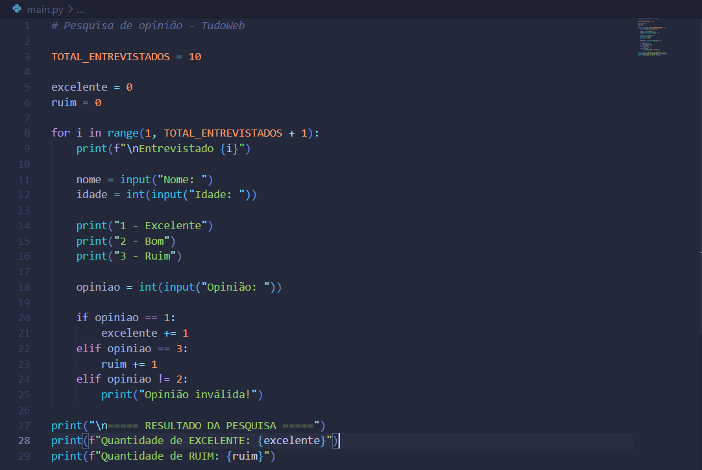
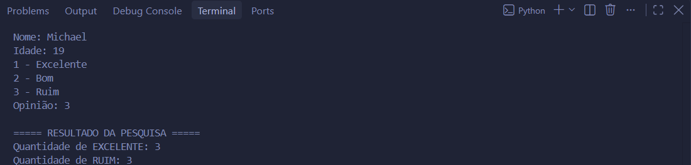

# Pesquisa de Opinião em Python

Projeto desenvolvido para a disciplina de Desenvolvimento de Sistemas.

## Objetivo

Realizar uma pesquisa de satisfação utilizando estruturas de repetição e decisão.

## Funcionalidades

- Cadastro de nome e idade
- Opinião do atendimento
- Contagem de respostas Excelente
- Contagem de respostas Ruim

## Tecnologias

- Python 3

## Código

## Execucação

